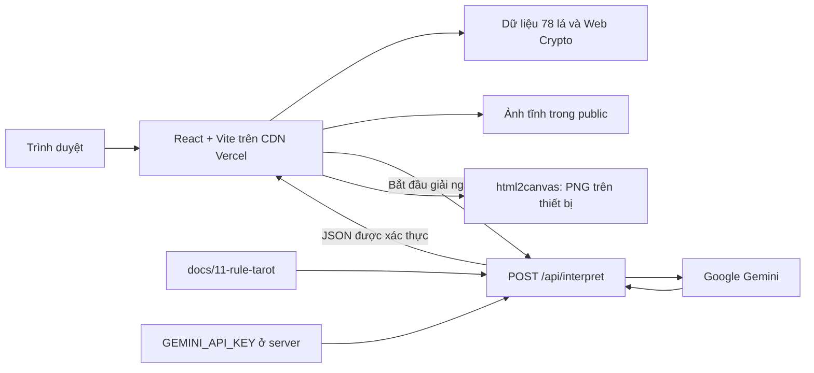

# 02 — Kiến trúc hiện tại

Lunara là một project React + Vite, có một Vercel Function không lưu trạng thái. Không có Ktor, Supabase, PostgreSQL, monorepo, Docker hoặc backend được triển khai riêng.

## Thành phần thực tế

| Thành phần | Công nghệ / vị trí | Trách nhiệm |
|---|---|---|
| UI | React state, `src/App.tsx` | Luồng chọn, rút, giải nghĩa từng lá, kết luận, thư viện |
| Style / chuyển động | CSS thuần, `src/styles.css` | Responsive, shuffle, deal, flip, glow, reduced motion |
| Domain | `src/data/tarotDeck.ts` | ID, tên, từ khóa, chủ đề, trải bài, rút ngẫu nhiên |
| Hợp đồng | Zod, `src/data/interpretation.ts` | Request/response, kiểm tra ID/vị trí/chiều và độ dài |
| API | `api/interpret.ts`, `server/interpret.ts` | Kiểm tra đầu vào, quota cục bộ, gọi provider và xử lý lỗi |
| Kho tri thức | `server/rules.ts`, `docs/11-rule-tarot` | Đọc rule, kiểm tra đủ 78 ID, chỉ chọn nghĩa các lá đã rút |
| Xuất ảnh | html2canvas lazy import | Tạo PNG đầy đủ ở client |
| Local API | Middleware trong `vite.config.ts` | Chạy cùng handler khi `npm run dev` |
| Kiểm thử | Node test + tsx; Vitest + jsdom | Endpoint/rule và tương tác UI |

## Ranh giới dữ liệu

- Web Crypto quyết định lá và chiều; Gemini chỉ diễn giải, không rút lại.
- Client giữ reading và lượt lật ban đầu trong bộ nhớ; Function không lưu phiên hoặc kết quả.
- Key không đi vào bundle, ảnh không gửi tới Gemini.
- Sau xáo/rút, người dùng lật ảnh như trước. Sau khi mở hết, nút Bắt đầu giải nghĩa ở dưới mới gửi câu hỏi. Một response chứa cả 1/3 lá và kết luận; hộp thoại hiện đủ các lá, chạm xem từng lá và nút kết luận chỉ mở nội dung đã nhận, không gọi lại provider.
- Trải bài mới hủy request phía client và bỏ qua phản hồi cũ. Giới hạn thời gian vẫn bảo vệ server nếu provider đang xử lý.
- PNG chỉ được mở sau kết luận (hoặc nội dung hỗ trợ an toàn); bản clone xuất tất cả phần nghĩa từng lá dù màn hình chỉ chọn một lá. Hàng ảnh ban đầu được bỏ khỏi PNG để không lặp bộ bài.

## Triển khai

Vercel phục vụ `dist/` và Function cùng origin. `vercel.json` đóng gói rule vào Function, đặt thời gian tối đa 60 giây. Server timeout 45 giây; client timeout 52 giây. Không rewrite `/api/interpret` về HTML.

`npm run preview` chỉ là static preview, không chạy endpoint. Cấu hình và hạn mức xem [README](../README.md#deploy-vercel-và-cấu-hình-gemini) và [vận hành](08-security-and-operations.md).

Các PNG kiến trúc trong [assets](../assets/README.md) thuộc bản thiết kế cũ, không mô tả runtime hiện tại.
